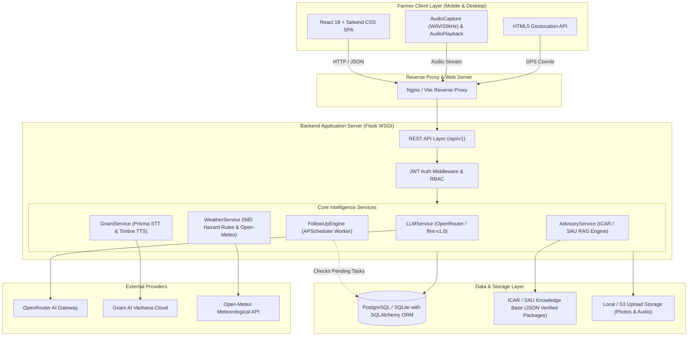
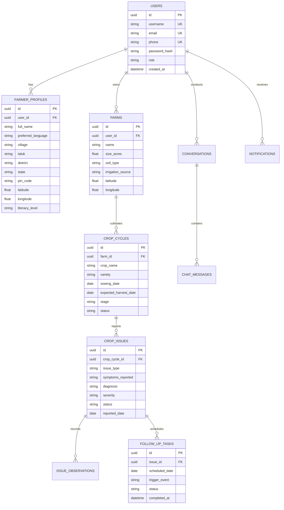
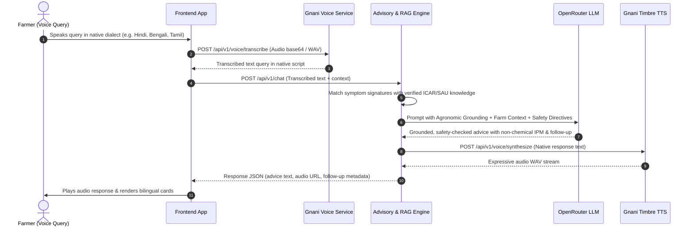

# KrishiVaani AI Architecture Specification

KrishiVaani AI (कृषिवाणी AI) is a production-grade, multimodal agricultural voice and intelligence platform engineered specifically for Indian smallholder farmers. The system synthesizes real-time regional speech processing, official ICAR/SAU agricultural research retrieval, hyper-local IMD meteorological hazard alerts, and an autonomous memory and follow-up engine across 27 Indian languages.

---

## 1. High-Level System Architecture

---

## 2. Relational Data Architecture

The underlying database is managed via SQLAlchemy ORM with migrations managed by Alembic. All multi-tenant data structures enforce tenant isolation (`user_id = current_user.id`).

---

## 3. Multimodal Voice & Reasoning Pipeline

---

## 4. Meteorological Hazard Engine

KrishiVaani automatically tracks hyper-local weather at farm GPS coordinates using Open-Meteo's meteorological models and evaluates official **India Meteorological Department (IMD)** hazard thresholds:

| Hazard Category | IMD Meteorological Criterion | Automated Farmer Advisory |
|---|---|---|
| **Heavy Rainfall** | Precipitation $\ge 64.5\text{ mm/day}$ | Clear field drainage channels immediately; pause foliar sprays and nitrogen fertilization to prevent runoff. |
| **Very Heavy Rainfall** | Precipitation $\ge 115.6\text{ mm/day}$ | Evacuate low-lying fields, store harvested produce on elevated platforms, safeguard machinery. |
| **Heatwave Warning** | Max Temp $\ge 40^\circ\text{C}$ in plains, departure $+4.5^\circ\text{C}$ | Apply evening light irrigation or micro-sprinklers; avoid midday chemical spraying to prevent leaf scorching. |
| **High Wind Alert** | Wind Speed $\ge 45\text{ km/h}$ | Provide staking for banana/papaya, postpone aerial drone sprays, inspect polyhouse tie-downs. |

---

## 5. Multilingual Translation Subsystem

The application supports **27 Indian native languages and dialects**:
- **Official Constitutional Languages (8th Schedule):** Hindi, Bengali, Telugu, Marathi, Tamil, Gujarati, Punjabi, Kannada, Malayalam, Odia, Assamese, Urdu, Maithili, Sanskrit, Konkani, Nepali, Sindhi, Kashmiri, Dogri, Manipuri (Meitei), Bodo, Santali.
- **Widespread Rural Dialects & Regional Variants:** Bhojpuri, Marwari, Chhattisgarhi, Haryanvi, and Indian English.

The architecture uses a unified key dictionary (`translations.ts`) coupled with language persistence in `FarmerProfile` and `localStorage`, ensuring zero flash-of-unstyled-language on reloads.
